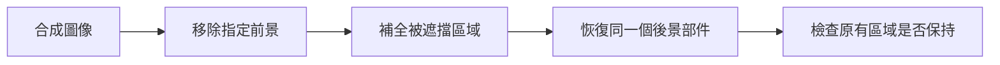
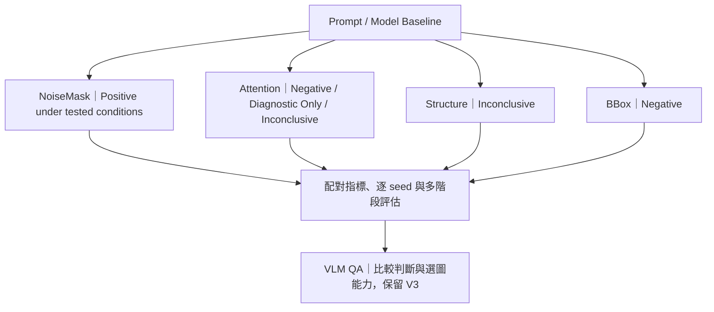

# ALDOC

**Automated Layer Decomposition and Occlusion Completion**

ALDOC 研究如何把一張非寫實 2D 插圖拆成美術可獨立移動、隱藏與重組的圖層。以硬幣遮住寶箱為例，移走硬幣後，寶箱仍應保有原來的鎖扣、輪廓與位置。遊戲 UI、角色立繪與分層動畫都需要這種可單獨使用的部件。

## 從插圖到可編輯圖層

Layer Lab 是團隊整合這套研究流程的原型。辨識模組決定先取哪個目標，SAM3 擷取可見輪廓，影像編輯模型移除目標並補回下方內容。VLM 分別檢查目標是否消失、露出的部位是否可用；系統在採用候選後才處理下一層。

| 分層方式 | 從哪裡開始 | 如何決定下一層 |
|---|---|---|
| Single-plan（自動工作的預設） | 在原圖建立圖層清單，獨立複查遮擋順序 | 依清單在目前影像定位目標。部位框輔助定位，每個清單元素輸出一層 |
| 三層架構（可選用） | S1 分開背景與前景集合 | S2 從更新後的前景逐一取出完整物件，S3 再拆各物件內的結構部件，保留最後本體 |

三層模式可輸出原畫布座標的 RGBA 圖層、重建圖、PSD 與階層關係。測試中的版本進一步記錄每個前景應歸屬的物件，以及物件內可獨立操控的部件。最新的 v1.9 從原圖裁出小部件及周邊像素進行分割與補繪，再將結果映回原座標。這些修改對可用圖層比例與人工修補時間的影響仍待驗證。[架構與版本差異](docs/system_evolution.md)

**三層分層的實驗怎麼做、得到什麼結果？** [分層實驗與模型分數](docs/experiments/10_hierarchical_evaluation.md) · [模型常駐、VRAM 與實測耗時](docs/experiments/11_gpu_runtime.md) · [圖層評估方法](docs/evaluation.md)

## Layer Lab 操作影片（既有遮罩流程）

https://github.com/user-attachments/assets/5b7b9321-4069-4f06-bf7e-644f1d1b779f

約 1 分 28 秒：**匯入插圖 → 加入遮罩 → 逐層補全 → 檢視與組合圖層 → 回看生成紀錄**。生成等待段已加速。

Demo 主要展示提供遮罩後的逐層補全與圖層操作；完整 Layer Lab 另整合團隊的自動分層模組。[操作說明](docs/system_evolution.md) · [下載 MP4](assets/prototype/Layer_Lab_DEMO.mp4) · [素材來源](docs/public_sources.md#demo-artwork)

## 遮擋補全研究

一般物件移除著重補出合理背景；本研究更要求恢復原本被遮住的「特定部件」（Amodal Completion）。例如補成另一個合理的寶箱，仍可能改錯鎖扣或箱體結構。

評估分成三個問題：**前景是否消失、後景是否補對、其他區域是否保持**。

## 研究歷程

先建立基準，再沿不同控制方向做比較；負結果與未定論同樣影響後續選擇。

圖中呈現 6–9 月的補全研究。Positive 限於合成資料自動指標；QA 的 V3 結論限於當時的固定候選比較。[研究時間軸與實驗分支](docs/experiments/00_research_timeline.md)

## 代表性研究結果

### NoiseMask｜降低無關區域變動

*Baseline 改變書本視角或產生多餘戒指結構；這兩例加入 NoiseMask 後更接近參考目標。[案例分析與完整 seed 比較](docs/qualitative_results.md#selected-improvements)*

Prompt-based editing 能執行移除，但非編輯區域仍可能被改動。因此在相同 Prompt V2 下加入 NoiseMask，保留非編輯區域的 latent，讓修改集中於指定範圍。

Synthetic V2 共 **30 experimental configurations × 27 samples × 5 seeds**，保存 4,050 筆分數；其中相同 Prompt V2 的配對比較如下（9-class macro）：

| 設定 | LPIPS ↓ | PSNR ↑ | SSIM ↑ |
|---|---:|---:|---:|
| Prompt V2 | 0.070 | 25.51 | 0.892 |
| Prompt V2 + NoiseMask 3% | 0.055 | 26.40 | 0.913 |

在目前 Synthetic Benchmark 的自動指標上呈現改善；人工品質仍需獨立判讀。[NoiseMask 實驗與限制](docs/experiments/03_noise_mask.md) · [完整數表](assets/results/paired/table.md)

### BBox Guidance｜負結果

為了讓模型知道要改哪裡，我比較綠框與線寬設定。FLUX.2 的 class-word baseline LPIPS 為 0.085，加入綠框後為 0.459；本設定下未觀察到改善，因此未納入主要流程。視覺框是否被當成內容，仍是可能解釋。[BBox 實驗](docs/experiments/02_region_guidance.md)

### VLM QA｜選到較好候選，與判定可用，是兩個問題

在固定候選的比較中，V7 的 strict stage pass 為 86.8%，V3 為 79.8%。V7 仍將部分關鍵負例判為可接受，當時的 benchmark 保留 V3。後續 Layer Lab 採用 V7 逐候選檢查，保留失敗與不確定的警示供人工複查。[VLM QA 實驗](docs/experiments/07_vlm_qa.md)

## 個人貢獻

本 repository 所呈現的圖像生成與補全研究，由我獨立進行研究設計、程式實作、實驗執行與評估分析。我的工作包含 baseline 與控制實驗、mask／evaluation utilities、失敗案例分析、VLM QA，以及生成側的系統整合；完整 Layer Lab 是團隊成果，自動分層模組由組員主要負責。[完整貢獻說明](docs/contributions.md)

## 完整研究紀錄

- [研究時間軸與實驗分支](docs/experiments/00_research_timeline.md)：包含負結果、未定論與歷史工作。
- [質化結果與失敗案例](docs/qualitative_results.md)：配對圖與所有 seed 的變化。
- [量化結果與多階段評估](docs/experiments/08_evaluation.md)：Synthetic V2／V3。
- [企業合作資料整體結果](docs/industry_aggregate_results.md)：QA、推論步數與生成設定比較。
- [評估方法與限制](docs/evaluation.md)：量測範圍、輸入條件與原始 CSV／JSON。
- [Selected Implementation](docs/selected_implementation.md)：精選工具、測試與執行方式。

## Repository Scope

這是研究展示 repository，收錄研究敘事、可公開結果與精選實作。企業合作資料僅提供整體量化結果；資料來源與重用條件見 [NOTICE](NOTICE.md) 與 [來源說明](docs/public_sources.md)。
