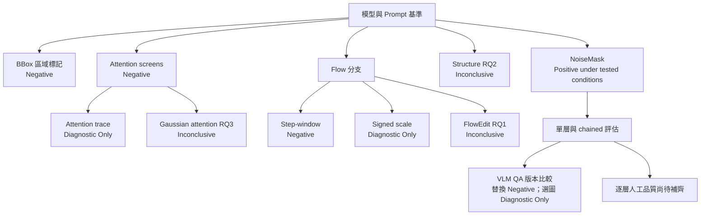

# 研究時間軸與分支

**2026-06-23 至 2026-11-20。** 補全研究先建立能重複比較的指定移除任務，再把模型、遮罩和品質檢查整合到 Layer Lab。以前景硬幣擋住寶箱為例，研究要確認的是寶箱輪廓、鎖扣和位置能否接回原樣。系統還要知道應先取哪個物件、遮罩切在哪裡，以及剩下哪些可用圖層。

讀表時，**seed** 是生成取樣的亂數種子，**配對**要求受測設定共用原圖和種子。**Oracle** 指研究已知的類別或遮罩，實際工作未必提供同等資訊。合成 GT 是依已知來源圖層建立的參考像素。流程進入終態、程式或模型給 PASS、操作者確認可用和正式採用，各自需有對應證據。LPIPS 越低越好，PSNR 與 SSIM 越高越好，僅在相同評分協定內比較。研究者自製素材與合作資料的結果亦按各自分母解讀。 [評估方法](../evaluation.md) · [來源與公開範圍](../public_sources.md)

## 6 月 23 日至 7 月｜建立可比較的補全問題

- **6/23～6/30。** 先建立請求、佇列、模型切換、輸出與記錄的通用執行流程。H200 上 12 組原生模型呼叫完成，批次總經過時間約 971.4 秒，量的是執行與傳輸流程。ConceptAttention 的定位檢查曾把狗與樹的位置判反，增加步數只恢復部分定位，舊的插圖部件定位結論撤回。首版合成資料記錄不足，後續另建可追溯的資料版本。 [早期執行與定位](09_historical_branches.md)
- **7 月。** Synthetic V2 固定 27 張圖 × 五 seeds。三個無類別提示詞基準的 object-centric LPIPS 為 FLUX.2 0.306、Qwen 2508 0.373、Qwen 2511 0.224，代表相同資料下三套實際推論設定。測過綠色 BBox、KV-Edit、Attentive Eraser、原生局部重繪與遮罩擴張。綠框結果依模型與評分條件而異，未成主要流程。Synthetic V3 將兩次移除串接，每模型 500 張輸出，確認第二階段能接第一階段的實際產物，逐層人工品質仍待補。本機 Klein 4B 輕量通道約 12～14 秒／圖、峰值 GPU 記憶體約 10.8 GiB，9 張只明顯補對 3 張。 [模型基準](01_baselines.md) · [區域控制](02_region_guidance.md) · [串接分數](08_evaluation.md) · [歷史分支](09_historical_branches.md)

## 8 月｜從受控補全轉向逐層選擇

- **8 月初。** Qwen 2511 的同提示詞比較每臂 135 張，加入 NoiseMask 3% 後，合成 V2 的 LPIPS 由 0.070 降至 0.055，PSNR 由 25.51 升至 26.40 dB，SSIM 由 0.892 升至 0.913，20/27 張原圖的 LPIPS 較低。遮罩來自已知合成資訊，這組結果只支持受測自動指標。多種額外 attention 控制也用同圖比較，未通過各自預設的篩選條件。 [NoiseMask](03_noise_mask.md) · [Attention 控制](04_attention_control.md)
- **8 月中。** 將辨識、命名、候選生成、品質判定與下一層輸入串接。曾有實驗完整執行，但成對的類別提示詞無法指定該移除的實際物件，因此該批不能回答原問題。後續另以固定、可核對的逐層語意重新測試。VLM 選擇也暴露順序偏差與證據圖角色混淆，改用明確列出候選資格的方式重測。這段研究建立了候選與人工評分的流程，Layer Lab 則由團隊整合自動分層、補全、複查與圖層匯出。 [歷史分支](09_historical_branches.md) · [候選品質](07_vlm_qa.md) · [系統演進](../system_evolution.md)
- **8 月下旬。** Flow step-window 在生成的指定步段加引導，四組共有 72 張輸出。配對人工比較中，引導組與原始基準各 12/18 通過，18 組逐對結果相同。另測正負引導幅度，留下自動指標供診斷。FlowEdit 在去噪時搬移編輯訊號、結構參考補形狀線索、Gaussian attention 強化可見部件等三條探索，仍缺完整成對品質驗證。 [Flow](06_flow_editing.md) · [結構參考](05_structure_guidance.md) · [Attention](04_attention_control.md)

## 8 月底至 9 月｜研究回放與產品流程各自驗證

342 張既有候選、114 個階段的固定回放中，V7 有 99/114 階段選到人工接受的候選，V3 有 91/114。V7 仍誤收已知不合格的測試案例，該研究比較保留 V3。9 月 Layer Lab 採 V7 逐候選檢查與記錄警示，並使用 single-plan 在原圖規劃清單，再按遮擋順序逐項處理。步數試驗每臂 190 張，4／10／20／30／40 步合計 950 張，平均單張推論時間依序為 6.09／14.26／36.69／54.66／66.48 秒，生成記錄的最高 PyTorch allocated 峰值為 67.92 GiB。各自動指標排序未一致，人工評估仍有缺口。Attention trace 記錄模型在哪些位置取資訊，供診斷使用。自製圖示的 720 張候選另有完整非盲人工評估，純提示詞 292/360 通過，提供 NoiseMask 遮罩的設定 318/360 通過。兩設定取得的區域資訊不同。 [QA 與重試](07_vlm_qa.md) · [步數與多階段評估](08_evaluation.md) · [產品流程](../system_evolution.md)

## 9 月底至 10 月｜區分即時重試和固定提示詞重跑

第一輪讓模型在補繪失敗後，於同一張來源圖與同一遮罩上重試，分為沿用原提示詞、局部修補（Patch）、完整重寫（Rewrite）。盲評集中於有觸發重試的 56 個單元、168 項判定，三臂各通過 42/56、50/56、46/56。兩個資料來源群的排序不同，尚不能據此估計全部輸入的成功率。第二輪凍結第一輪已形成的三臂提示詞，讓 56 個單元以相同五 seeds 配對，各臂 280 張，合計 840 張，不再即時產生新提示詞。盲化複評後三臂各通過 179/280、214/280、230/280。以 37 張來源圖等權計算，通過率為 71.9%、81.6%、87.7%。結果支持在這批已觸發重試的案例重用修補或重寫的提示詞。Rewrite 對 Patch 的配對信賴區間跨零，兩者排序未定。10 月下旬接入 Layer Lab 的則是運行中產生回饋的重試。該批 120 個產品工作已進入終態，流程終態與交付品質分別記錄。 [品質判定與兩輪重試](07_vlm_qa.md) · [合作資料僅整體量化](../industry_aggregate_results.md) · [系統工作流](../system_evolution.md)

## 11 月 1 日至 20 日｜分層交接、整卡量測與工程驗收

- **11 月上旬。** 無補全的可見分層交接，三場景、兩條路徑共 6/6 次走完，用來確認階層資料交接。另將規劃模型與補繪模型常駐於同一張 GPU。19 張 × 三 seeds 的 single-plan 共 57/57 個工作走到清單結尾，SAM 階段實測整卡最高 94.96 GiB，這是包含同時常駐模型的整張卡用量。兩位 AI 審閱 136 張已採用補繪，以整張圖計 88 pass、48 fail，仍需正式美術評估。 [分層交接與模型對照](10_hierarchical_evaluation.md) · [常駐與顯存量測](11_gpu_runtime.md)
- **11 月中旬。** 三階段模式以 S1 分開背景與可見前景，S2 抽出完整物件，S3 再拆出物件內可操作部件。v1.6 的 22 張 × 三 seeds 工程批次有 66 個終態，6 completed、60 needs_review。三場景各三次都通過 PNG／PSD 重建檢查，九次都只交付部分結果，2/9 有實際採用的 S3 拆分。這九次操作中，VLM、SAM3、補繪的中位時間分別為 15.32、31.97、42.09 秒，SAM3 的整卡最高採樣值為 94.79 GiB。這些是單次操作時間，原圖工作另含等待、重試與匯出。早期批次暴露物件錯併、小部件漏切及 QA 指到未選區域等問題。 [分層實驗與限制](10_hierarchical_evaluation.md) · [實圖耗時與顯存](11_gpu_runtime.md)
- **至 11/20。** v1.7～v1.9 加入歸屬驗證、局部重切與回貼，並調整提示詞與定位，依序記錄 837、849、855 項 CPU 測試通過。另規劃三場景 × 十個預定 seeds 的實驗，仍待完整結果與人工品質確認。公開紀錄保存量化結果和可公開方法。新版本在相同圖與 seeds 的實圖配對、美術可用圖層比例與修整工時仍待驗收。 [版本對照](10_hierarchical_evaluation.md) · [研究結論與待驗收項目](../research_summary.md)

## 早期補全研究分支示意

圖中保留 6 月至 9 月的研究分支與當時判讀。NoiseMask 的 Positive 限於已測合成資料的自動指標，V3 是該次固定候選研究的保留結論。

## 依問題深入閱讀

| 想查的問題 | 詳細頁 |
| --- | --- |
| 提示詞與模型基準、綠框、遮罩控制 | [Baseline](01_baselines.md) · [BBox](02_region_guidance.md) · [NoiseMask](03_noise_mask.md) |
| Attention、結構參考與 Flow 為何停止或待測 | [Attention](04_attention_control.md) · [Structure](05_structure_guidance.md) · [Flow](06_flow_editing.md) |
| 人工如何複評、重試有多少收益 | [VLM QA 與重試](07_vlm_qa.md) |
| 單層、多層、步數及其他歷史分支 | [多階段評估](08_evaluation.md) · [歷史分支](09_historical_branches.md) |
| 圖層拆分、版本、時間與顯存 | [分層架構實驗](10_hierarchical_evaluation.md) · [GPU 實測](11_gpu_runtime.md) |
