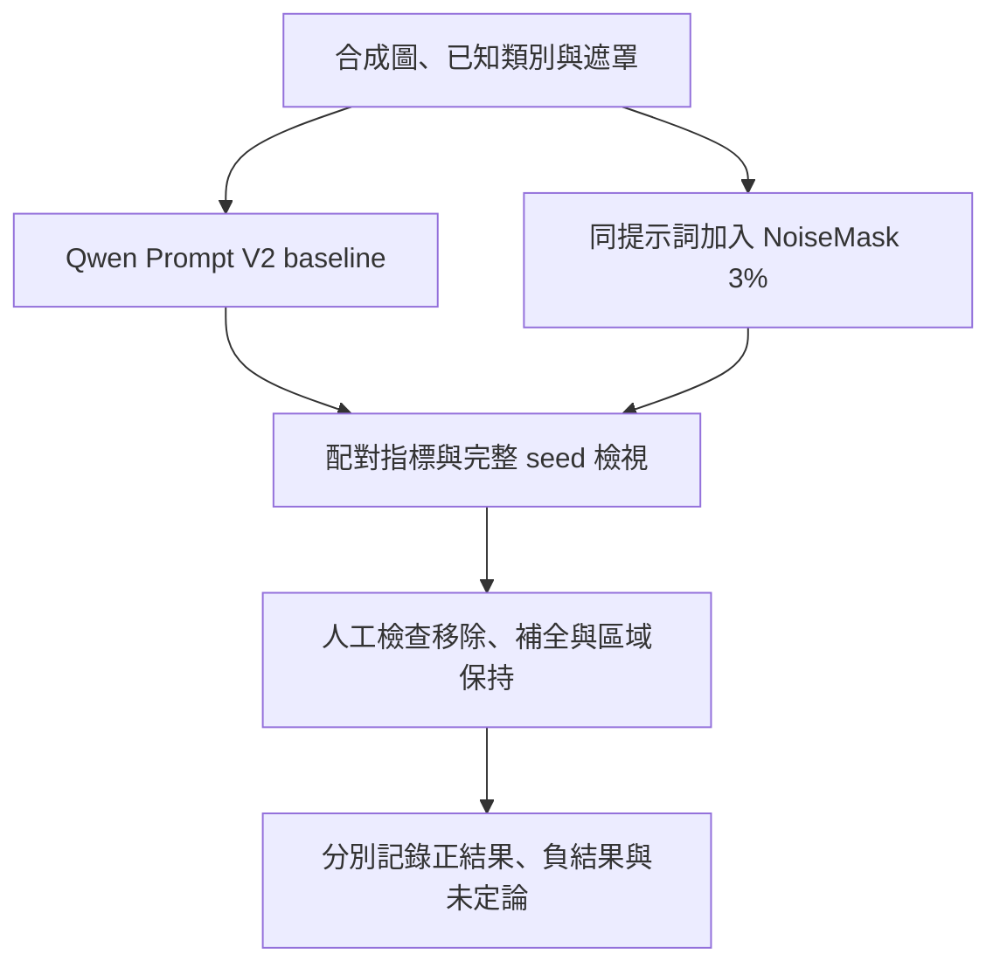

# ALDOC 的研究問題與目前證據

分層可用性取決於三個連續決定：辨識要移動的完整物件、取出正確輪廓、恢復下方被遮住的結構。以前景遮住寶箱為例，即使鎖扣補得合理，若遮罩切掉箱蓋或整個箱體偏移，該層仍需要美術修正。Single-plan 在原圖上固定圖層清單，整合版三層模式則分別辨識場景、物件與部件。實驗版進一步記錄每個前景歸屬哪個物件、每個部件由哪個父層取出，以及選用候選後應更新哪些輪廓。[系統架構與版本差異](system_evolution.md)

## 截至 2026-11-20 的主要發現

**限制無關修改，是補全品質的重要一環。** 在已知類別與遮罩的合成資料條件下，Qwen Prompt V2 加入 Lab NoiseMask 3% 後，自動指標改善；但寶箱鎖扣等細節仍可能被改寫，人工品質須另外判讀。[NoiseMask 實驗](experiments/03_noise_mask.md)

**更複雜的控制沒有自然帶來更好的結果。** BBox 與已測 Flow step-window 保留負結果；Attention screens 有限定範圍負結果，trace 僅供機制觀察；Structure、FlowEdit RQ1 與 Attention RQ3 仍缺完整品質比較。[研究分支](experiments/00_research_timeline.md)

**QA 的選圖能力與判定可用的能力，需要分開衡量。** 歷史 frozen replay 中，V7 改善部分選圖指標，但仍誤收關鍵負例，該研究協定保留 V3。後續 Layer Lab 採用 V7 逐候選檢查並記錄警示。[VLM QA](experiments/07_vlm_qa.md)

**已產生的回饋提示詞在受測重試案例有收益。** 56 個已觸發重試的單元 × 三種固定提示詞 × 五 seeds，共 840 張。盲化複評中，原提示詞、Patch、Rewrite 分別通過 179/280、214/280、230/280。以來源圖等權計，分別為 71.9%、81.6%、87.7%。Rewrite 相對 Patch 的配對信賴區間跨零。這組固定提示詞試驗與會即時產生回饋的產品重試各有分母。 [QA 與重試](experiments/07_vlm_qa.md)

**端到端終態仍有品質缺口。** 雙模型常駐的 single-plan 批次 57/57 走到清單結尾，SAM 階段整卡最高 94.96 GiB。136 張採用補繪的整張畫面雙 AI 複審為 88 pass、48 fail。三階段 v1.6 有 66 個工程終態，包括 6 completed、60 needs_review。三張場景圖各跑三次，共 9 次都通過 PNG／PSD 重建檢查，9 次都只得到部分結果，2 次實際採用 S3 部件。v1.7～v1.9 的 CPU 回歸測試依序通過 837、849、855 項，逐層美術可用性仍待同設定實圖對照。 [顯存與耗時](experiments/11_gpu_runtime.md) · [分層實驗](experiments/10_hierarchical_evaluation.md)

**部件歸屬與裁切尺度要分別驗證。** 一個遮罩可能沿著輪廓切得很好，卻切到相鄰物件；也可能找對物件，卻在縮圖時漏掉小部件。三層實驗因此區分規劃歸屬、遮罩與補繪候選，並以局部修補和原畫布重組檢查座標。工程測試能檢出錯誤回貼，實圖則需核對歸屬、遮擋及部件能否獨立使用。[三層實驗方法與數據](experiments/10_hierarchical_evaluation.md)

## 如何隔離補全模組的效果

這組比較固定已知類別與遮罩，隔離 Qwen class-word Prompt V2 加入 Lab NoiseMask 3% 的效果。完整系統還須計入前後順序、定位、分割與先前補繪造成的誤差。

Layer Lab 是已整合的預發布原型。它優先採用通過 QA 的候選；沒有通過者時，可保留 fail／uncertain 提示供使用者檢視、選擇目前較佳結果或重新生成。研究仍依獨立品質判定記錄這些結果。[系統操作](system_evolution.md) · [評估方法](evaluation.md)

## 尚未解決的問題

- **特定部件的恢復**：外觀合理仍可能改錯鎖扣、幾何或紋理，需要對照真正目標逐項檢視。
- **RGBA 圖層可用性**：長期目標是可獨立使用的完整部件；歷史合成實驗多以黑底 RGB surrogate 評估，系統輸出的 alpha、位置與部件內容仍需逐層驗證。
- **人工與多階段評估**：Prompt V2 配對、V3 Stage 2 與 steps 比較仍有人工判讀缺口；重建圖也可能遮住下層問題。
- **結構與生成機制**：Structure guide 可建構，但品質收益未測；FlowEdit RQ1 與 Attention RQ3 需完成自己的配對比較。
- **拆分方式與人工修補成本**：在同一張圖、同樣隨機與推論條件下比較 single-plan 和三階段模式，逐物件記錄遺漏、錯併、可用圖層與修補時間。
- **真實美術泛化**：合成資料可支援控制實驗，普遍美術效果仍需要權利明確、artist-authored 的部件級 benchmark 與人工評估。模型推測的遮罩或補全圖僅能作輔助參考。

[完整時間軸](experiments/00_research_timeline.md) · [質化結果與失敗案例](qualitative_results.md) · [企業合作資料整體結果](industry_aggregate_results.md)
