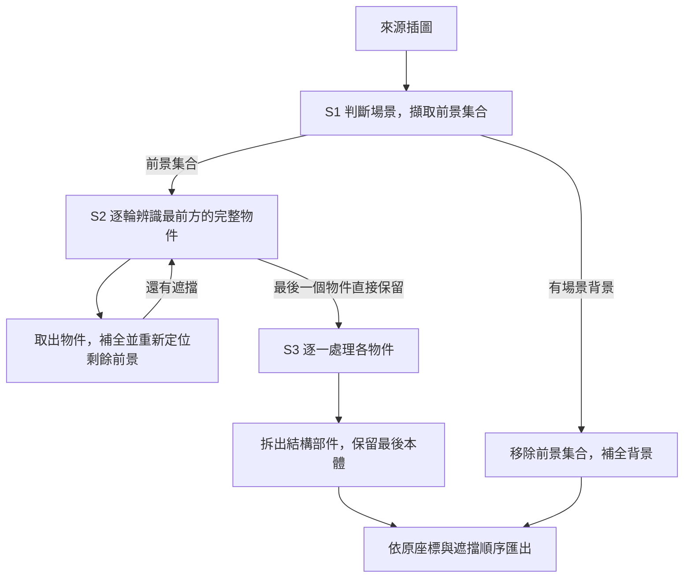

# Layer Lab 的分層與遮擋補全架構

ALDOC 追蹤一個部件從「圖上可見」到「可被美術獨立使用」的過程。Layer Lab 將辨識、分割、補全、候選評估與圖層匯出串成可續跑的工作流。截至 2026 年 11 月 20 日，整合版以 single-plan 為預設，並提供選用的三層基準。另一條實驗開發線已演進至 v1.9，主要差異是如何保存物件歸屬，以及小部件使用多大的輸入視野。[三層實驗方法與數據](experiments/10_hierarchical_evaluation.md)

## 預設流程如何逐層處理

1. **規劃前後順序。** Single-plan 從原圖列出可以整體取出的元素與其部位框，再獨立複查遮擋順序。每個清單元素對應一個輸出層。第一層使用目標與所屬部位的聯集框；從第二層起，定位複查可在最新採用的影像上重新找出同一目標。既有的逐輪模式則會在每次補繪後重新辨識下一個前景。
2. **取出前景。** SAM3 依目標描述與位置分割，取得可見像素。命名提供補全模型要移除的對象。若已有美術指定的遮罩，也可依指定順序處理。
3. **補回被遮住的內容。** Qwen Image Edit 移除這一層前景並補繪後方。預設 20 steps，深度引導預設關閉。
4. **檢查後再推進。** Completion QA V7 先比對前景裁圖與候選，檢查目標是否殘留；若已確認殘留，這個候選直接失敗。其餘候選再用對齊的來源與結果檢查補全。每層最多生成三次，第一個通過的候選即可採用。重試沿用該層的生成前影像與遮罩；若都未通過，可保留有效候選並標記風險，後續圖層繼承警示。

## 整合版的三層基準

較早的 H/D 實驗比較兩種拆法。H 先在整圖區分背景與前景集合，D 直接在整圖列物件，兩者再於各物件內列部件。每次 VLM 只讀當前節點的一張圖，SAM 用名稱與位置切出可見像素，子節點使用裁出的圖。被前景完全遮住的內容留到後續的補全研究處理。[H/D 實驗方法與結果](experiments/10_hierarchical_evaluation.md)

`hierarchical_v1` 以一張來源圖啟動，整合基準的提示版本為 v1.1。三層基準的 VLM、分割器與編輯器分別使用 Qwen3.8-27B、SAM3 與 Qwen Image Edit 2511。VLM 依輪廓的中斷與延續判斷誰遮住誰，用位置區分同類實例；每輪鎖定實例、位置、應包含與排除的部位。命名時可調整顯示名稱，生成與評估仍沿用完整目標。提供既有遮罩或 Depth 引導的工作使用既有流程。

| 層級 | 研究問題 | 處理方式 |
|---|---|---|
| S1 場景 | 移走所有前景後，哪些像素屬於環境？ | 場景圖可產生補全背景。透明或人工底板可直接處理前景集合；若判定只有背景，流程可在此結束。 |
| S2 物件 | 目前最上方、可以整體移動的是哪個物件？ | 每輪鎖定一個實例並檢查遮擋。取出後補繪其下方，再從新影像辨識剩餘前景的輪廓，讓新露出的物件有機會進入下一輪。 |
| S3 部件 | 每個物件內，哪些結構值得單獨操作？ | 逐一處理 S2 的物件，例如將可活動的配件與本體分開。最後本體直接分割、複查並保留，避免多做一次清空畫布的補繪。 |

**選回先前候選時，哪些圖層要重算？** 每次採用都保存來源與產出版本。例如 S2 改選一張寶箱補全圖，依舊寶箱抽出的後續物件或 S3 部件都需要重算，未依賴舊圖的分支可保留。若某分支無法繼續，系統保留其剩餘圖像與警示。

**如何重組？** RGBA 圖層保留原畫布座標。`hierarchy.json` 記錄父子關係。重建 PNG 與 PSD 使用相同的末端部件和保留本體；PSD 隱藏已拆開的父物件預覽，避免同一物件疊兩次。美術可隱藏前景，直接查看露出的輪廓和補畫區。

## 測試中的版本如何處理歸屬與小部件

實驗開發沿用 S1／S2／S3，由逐輪辨識推進到先建立物件與部件清單，再於當前影像定位。兩種做法對新露出的像素有不同要求：整合基準可以在下一輪辨認新物件；清單版本先遵守已確認的歸屬，新增項目須有可追溯的影像證據。

| 實驗版本 | 改了哪個決定 | 對輸出有何影響 |
|---|---|---|
| v1.2 | 由逐輪自由選目標改為階段清單。S1 要列出可見內容，後續以固定的實例識別追蹤待處理項目，供遮罩 QA 核對。 | 改選較早候選時，要撤銷依舊剩餘圖新增的清單項目。該版留有 CPU 契約驗證；欠缺獨立的實圖品質比較。 |
| v1.3 | S2 依輪廓連續、接合與遮擋證據分出完整物件，附件留給所屬物件。S3 只在同一父物件內挑有編輯、定位或控制用途的部件，最後保留本體。 | 凍結版本會將 S1 全部可見項目併入應包含清單，可能與已排除的背景矛盾。後續即使沿指定輪廓切準，仍可能切錯歸屬。 |
| v1.4（草稿） | S1 明辨有畫面內容的設計底板、外部空白、純背景和歸屬未定。確認無背景就將原圖直接交給 S2，略過 S1 集合分割與補繪。 | 可避開無背景圖的額外編輯。草稿當時尚未將 S1 歸屬完整傳給 S2，其效果須與後續版本分開判讀。 |
| v1.5 | 將 S1 歸屬傳給 S2 規劃與重新定位。每個補繪候選分別檢查目標移除與剩餘 alpha，保留通過兩項檢查的結果。 | 清單仍有實例時，空遮罩會阻擋該候選；有限底板需恢復自身範圍，外部畫布保持透明。 |
| v1.6 | S3 先列同一物件內可獨立編輯的部件，再把排除這些部件後的結構指定為最後本體。 | 定位與補畫剩餘本體時使用排除清單，避免把已經獨立取出的部件再要求一次。 |
| v1.7 | S1 將可見內容分為前景、背景、外部畫布或未定。S2 要求每個前景實體恰好歸屬一個完整物件，合併附件要有可見結構的理由。S3 部件限於單一父物件，並說明可控制的姿態、關節、表情或替換用途。 | 遮罩若只漏掉一個可定位的部件，可在剩餘嘗試額度內用局部框重切，映回原圖後複查完整目標。若 QA 建議移除某區，該區卻沒有選取像素，控制器以全圖和對齊裁圖重新核對。 |
| v1.8 | 把 VLM 問題與回答欄位限於當前階段，各自詢問場景歸屬、物件組成或單一父物件內的部件。 | 沿用三層的編輯用途判準，調整模型做每個決定時所見的指示與所需回答。 |
| v1.9 | S3 保留全圖參照，改以父物件非透明範圍及周邊原始像素規劃部件，再用局部視野分割與補繪。 | 輪廓被內部裁切邊界截斷時，可用剩餘額度回到全圖分割。補繪後將有效編輯區映回原畫布，區外保留原 RGBA；候選 QA 可對照全圖及局部細節。 |

以有把手的杯子為例，整杯移動時，把手應歸在杯子上；若美術需要獨立替換把手，S3 才有理由把它列為部件。這是判讀方式的示例。模型仍可能把同義描述誤認為不同物件，或誤判遮擋順序。控制器可攔下清單矛盾、座標錯置與無效候選，實際切出的部件是否完整仍需逐層檢視。[三層實驗的條件與證據](experiments/10_hierarchical_evaluation.md)

## SAM3 如何從目標取出圖層

1. **給定目標與空間範圍。** 三層模式將當輪影像、正向名詞描述與一個正向 BBox 送入 SAM3。方框使用 0–1000 的左上、右下座標，轉成模型所需的中心與寬高。S1 可以一次描述整個前景集合，S2 鎖定一個實例，S3 鎖定單一父物件內的部件。v1.9 可對局部影像送出換算後的方框。
2. **從一次 SAM 回傳中選候選。** 每張候選的像素前景機率大於 0.5 才進入二值遮罩。捨棄空遮罩，再算「正框內的遮罩像素數 ÷ 全部遮罩像素數」，至少一半在框內才能參選。從合格候選中取 SAM 分數最高者，同分取先出現者，另記輪廓在不同機率門檻下的穩定度。舉例而言，一個 100 像素的候選若只有 40 個像素落在框內，即使模型分數最高也會被淘汰。
3. **檢查切到誰、漏掉什麼。** 控制器把選取輪廓對齊來源 alpha，保留同一目標可能分離的可見片段。遮罩 QA 再檢查必要構造、鄰物污染、遮擋者與真正開口。一次 SAM 回傳的候選排名和控制器的重試額度分開計算：每個拆分回合最多三個遮罩嘗試，重新選擇遮擋順序也共用額度。v1.7 起，乾淨候選若只漏一塊可定位的部件，可局部再切、映回畫布並重新審查完整目標。
4. **產生取出層與補繪區。** 匯出時以採用的 alpha 擷取 RGBA。送影像編輯器的移除遮罩可外擴以清掉邊緣，輸出圖層沿用原 alpha。補繪後，系統在新影像上重新定位、分割剩餘前景，讓後續物件使用更新後的輪廓。

## 每一層移除了什麼，又該補回什麼？

| 階段 | 先檢查是否移除 | 再檢查補全是否可用 |
|---|---|---|
| S1 | 整個前景集合 | 指定的場景背景、圖案底板或面板能否連續接合 |
| S2 | 選定的完整物件及其附件 | 其餘物件是否保留各自的身分、結構與附件 |
| S3 | 選定的內部部件 | 同一父物件剩餘的本體與部件是否完整 |

若已確認目標殘留，該候選跳過補全評估。進入補全評估時，每個剩餘實體與新露出的結構都須定位在候選圖上；要判定一處補畫有依據，須指出編輯前影像上支持該處的可見線索。例如杯口的弧線能支持杯緣的延續，把手的走向仍需自己的依據。逐項對照物件清單、採用的遮罩與補畫證據，才看得出錯誤發生在目標歸屬、輪廓擷取或生成哪一步。

## 執行與品質證據

操作介面與批次入口使用同一工作流。單一工作佇列將模型操作交給獨立的 GPU 執行程序。每次先寫妥圖層和候選，再更新 checkpoint；中斷後可從最後採用的狀態續跑。技術故障的重試保留原有 seed 與推論設定，並與品質候選額度分開計數。補繪的提示詞可固定，或在 V7 找到明確缺陷時以局部修正或完整重寫進行下一次生成。若只由生成圖推測某物件曾被遮住，會保留來源不確定的警示。

既有工程測試涵蓋分層切換、候選重選、續跑及匯出合成。三層模式能否提高可用部件比例、減少人工修補，仍需在相同來源下比較兩種流程，並逐層檢查 RGBA 與 PSD。[評估方法](evaluation.md)

11/09 的整合測試覆蓋冪等提交、來源與產出版本依賴、GPU 資源拒絕後的安全接續，及獨立執行程序的故障恢復。初版 680 項 CPU 測試通過，接續修正後 692 項 CPU 通過。長輸出 VLM 後續另加入有界 watchdog，並保存中斷時的狀態。實圖 GPU 小樣本確認可交付 RGBA／PSD 與重組，S3 首輪直接保留本體。v1.7～v1.9 的工程回歸分別有 837、849、855 項 CPU 測試通過，實圖配對及人工驗收仍待完成。[各版驗收](experiments/10_hierarchical_evaluation.md) · [GPU 實測](experiments/11_gpu_runtime.md)

森林、海灘、月夜的原圖與動畫參考是研究者自製的生成概念素材。工作流試跑輸出的遮罩、補繪及 RGBA／PSD 是各次執行的產物，須按該次終態及候選評審判讀。概念參考層沒有隱藏區域的美術師真值；內嵌操作影片則沿用其獨立的公開素材來源。[素材與授權](public_sources.md)

## 操作影片：提供遮罩後的逐層補全

這段早期影片展示如何從一張插圖與既有遮罩出發，逐層補全被遮擋內容，再檢視與組合圖層。三層模式的步驟見上方架構圖。

https://github.com/user-attachments/assets/5b7b9321-4069-4f06-bf7e-644f1d1b779f

約 1 分 28 秒。[下載 MP4](../assets/prototype/Layer_Lab_DEMO.mp4)

### 1. 匯入素材

匯入原圖，在工作區檢視待拆解的插圖。

### 2. 設定遮罩

加入各部件的 masks，指定圖層範圍。勾選遮罩並調整顯示透明度，確認遮罩與原圖的對應位置。

### 3. 逐層生成與補全

選擇品質或快速模式後開始生成，系統依序處理各圖層並補全被遮擋的內容。影片中的生成等待段已加速。

### 4. 檢視與組合圖層

單獨顯示物件或人物，檢查透明背景上的補全結果；切換背景及其他圖層，預覽不同組合的合成效果。

### 5. 回看補全紀錄

開啟各圖層的紀錄，回看生成候選，對照目前顯示的結果。

影片素材與衍生內容的來源見 [Demo artwork](public_sources.md#demo-artwork)。補全品質的實驗比較與失敗案例見 [Qualitative Results](qualitative_results.md)。

自動分層由組員主要負責，我的工作集中在生成／補全研究、VLM QA 與生成側整合。[個人貢獻](contributions.md) · [研究發現與開放問題](research_summary.md)
