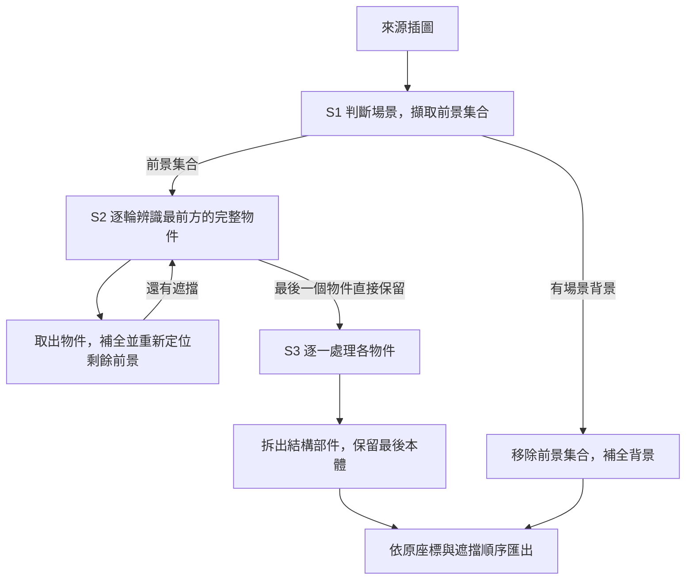

# Layer Lab 的分層與遮擋補全架構

ALDOC 追蹤一個部件從「圖上可見」到「可被美術獨立使用」的過程。Layer Lab 將辨識、分割、補全、候選評估與圖層匯出串成可續跑的工作流。以下依 2026 年 11 月 19 日核對的開發版本說明。

## 預設流程如何逐層處理

1. **規劃前後順序。** Single-plan 從原圖列出元素與部位框，再獨立複查遮擋順序。第一層使用初始聯集框；從第二層起，定位複查可在最新採用的影像上重新找出同一目標。
2. **取出前景。** SAM3 依目標描述與位置分割，取得可見像素。命名提供補全模型要移除的對象。若已有美術指定的遮罩，也可依指定順序處理。
3. **補回被遮住的內容。** Qwen Image Edit 移除這一層前景並補繪後方。預設 20 steps，深度引導預設關閉。
4. **檢查後再推進。** Completion QA V7 先比對前景裁圖與候選，檢查目標是否殘留；若已確認殘留，這個候選直接失敗。其餘候選再用對齊的來源與結果檢查補全。每層最多生成三次，第一個通過的候選即可採用。重試沿用該層的生成前影像與遮罩；若都未通過，可保留有效候選並標記風險，後續圖層繼承警示。

## 測試中的三層架構

`hierarchical_v1` 是已實作的選用模式，以單張來源圖啟動。提供既有遮罩或 Depth 引導的工作使用既有流程。

| 層級 | 研究問題 | 處理方式 |
|---|---|---|
| S1 場景 | 移走所有前景後，哪些像素屬於環境？ | 場景圖可產生補全背景。透明或人工底板可直接處理前景集合；若判定只有背景，流程可在此結束。 |
| S2 物件 | 目前最上方、可以整體移動的是哪個物件？ | 每輪鎖定一個實例並檢查遮擋。取出後補繪其下方，再從新影像辨識剩餘前景的輪廓，讓新露出的物件有機會進入下一輪。 |
| S3 部件 | 每個物件內，哪些結構值得單獨操作？ | 逐一處理 S2 的物件，例如將可活動的配件與本體分開。最後本體直接分割、複查並保留，避免多做一次清空畫布的補繪。 |

**遮罩有兩種用途。** 匯出的 alpha 決定圖層可見邊界，補繪遮罩則可外擴以清除前景邊緣。外擴量只作用於編輯區。細線、分離的小元件與真正的孔洞都可能屬於原畫，修補遮罩時只填入已有局部證據的錯洞。

**選回先前候選時，哪些圖層要重算？** 每次採用都保存來源與產出版本。例如 S2 改選一張寶箱補全圖，依舊寶箱抽出的後續物件或 S3 部件都需要重算，未依賴舊圖的分支可保留。若某分支無法繼續，系統保留其剩餘圖像與警示。

**如何重組？** RGBA 圖層保留原畫布座標。`hierarchy.json` 記錄父子關係。重建 PNG 與 PSD 使用相同的末端部件和保留本體；PSD 隱藏已拆開的父物件預覽，避免同一物件疊兩次。美術可隱藏前景，直接查看露出的輪廓和補畫區。

## 執行與品質證據

操作介面與批次入口使用同一工作流。單一推論工作佇列依序執行模型操作。每次採用結果時保存 checkpoint，讓中斷後可從最後採用的狀態續跑。技術故障的有限次重試和因畫面缺陷重新生成的候選分別計數。

既有工程測試涵蓋分層切換、候選重選、續跑及匯出合成。三層模式能否提高可用部件比例、減少人工修補，仍需在相同來源下比較兩種流程，並逐層檢查 RGBA 與 PSD。[評估方法](evaluation.md)

## 操作影片：提供遮罩後的逐層補全

這段早期影片展示如何從一張插圖與既有遮罩出發，逐層補全被遮擋內容，再檢視與組合圖層。三層模式的步驟見上方架構圖。

https://github.com/user-attachments/assets/5b7b9321-4069-4f06-bf7e-644f1d1b779f

約 1 分 28 秒。[下載 MP4](../assets/prototype/Layer_Lab_DEMO.mp4)

### 1. 匯入素材

匯入原圖，在工作區檢視待拆解的插圖。

### 2. 設定遮罩

加入各部件的 masks，指定圖層範圍。勾選遮罩並調整顯示透明度，確認遮罩與原圖的對應位置。

### 3. 逐層生成與補全

選擇品質或快速模式後開始生成，系統依序處理各圖層並補全被遮擋的內容。影片中的生成等待段已加速。

### 4. 檢視與組合圖層

單獨顯示物件或人物，檢查透明背景上的補全結果；切換背景及其他圖層，預覽不同組合的合成效果。

### 5. 回看補全紀錄

開啟各圖層的紀錄，回看生成候選，對照目前顯示的結果。

影片素材與衍生內容的來源見 [Demo artwork](public_sources.md#demo-artwork)。補全品質的實驗比較與失敗案例見 [Qualitative Results](qualitative_results.md)。

自動分層由組員主要負責，我的工作集中在生成／補全研究、VLM QA 與生成側整合。[個人貢獻](contributions.md) · [研究發現與開放問題](research_summary.md)
